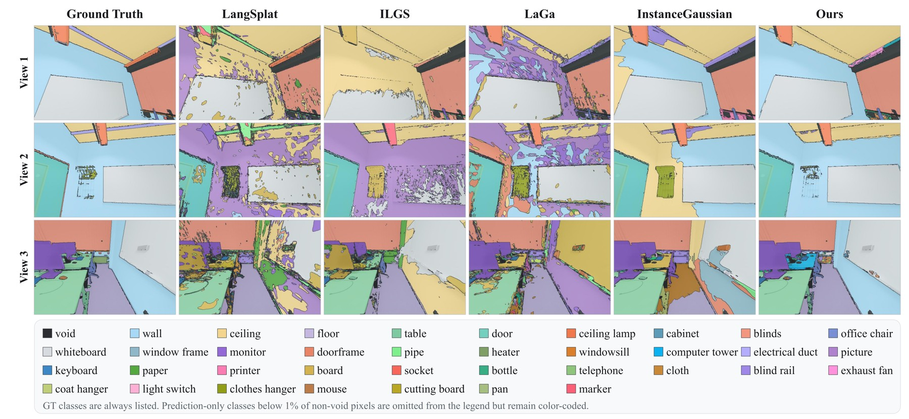
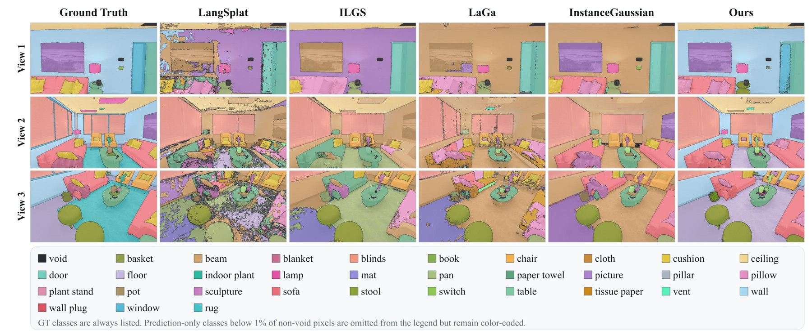

# InstGuide-GS

**Instance-Guided Semantic Learning for Open-Vocabulary 3D Gaussian Splatting**

InstGuide-GS reconstructs category-level open-vocabulary semantics in static
indoor scenes. It extends Scaffold-GS with:

1. a geometry-indexed, instance-level semantic teacher that aggregates
   multi-view CropFormer masks with Alpha-CLIP features and stores one prototype
   per 3D instance; and
2. geometry-guided Anchor-Offset semantics, where an Anchor stores a shared base
   latent and only transition or geometrically uncertain Anchors allocate
   low-rank child-Gaussian residuals.

## Results

**ScanNet++ Scene 2.** Cross-view semantic segmentation from the manuscript.



**Replica room0.** Cross-view semantic segmentation from the manuscript.



These previews of the manuscript figures retain their GT, method labels and
class legends.

## Installation

Use two Linux server environments: teacher generation uses Python 3.8 / PyTorch
2.0.0 / CUDA 11.8; 3DGS training and evaluation use the Python 3.11 / PyTorch 2.10.0 /
CUDA 12.8 server reference. Both environments, native builds and checks are in
**[environment.yml](environment.yml)**. Do not merge their dependencies.

For the 3DGS stage, start with:

```bash
conda env create -f environment.yml
conda activate instguide-gs
# Complete the native-extension installation commands in environment.yml.
```

Teacher generation requires the separate `instguide-teacher` setup in that same
file, including Detectron2, PyTorch3D and CropFormer's CUDA attention operator.
An existing portable teacher can be used without installing these dependencies
in the 3DGS environment. The references are not a bitwise environment lock;
verify native operators on the target GPU before a full run.

Download weights separately; see [checkpoint names and hashes](third_party/checkpoints/README.md).
Alpha-CLIP text evaluation also needs the base `ViT-B-16.pt`, not only the visual
checkpoint. Use the same encoder family as the teacher. The launchers require Bash.

## Data layout

A scene must provide registered images and a COLMAP sparse model:

```text
SCENE/
  images/
  depths/                 # registered depth for teacher construction
  sparse/0/cameras.txt
  sparse/0/images.txt
  sparse/0/points3D.ply
  INSTANCE_MESH.ply        # exact geometry indexed by object_dict.npy
```

Training also accepts `cameras.bin` + `images.bin`, using the same binary-first
selection as the scene loader. Initial points may be PLY, COLMAP BIN, or TXT;
the scene loader converts the latter two to PLY. The bundled teacher-generation
reader/CropFormer runner still uses COLMAP TXT files, so supply TXT exports for
teacher generation even when the geometry trainer uses BIN.

Depth maps are used by the RGB-D teacher construction pipeline. The public
geometry launcher trains RGB reconstruction without depth supervision; the
semantic loss also does not use depth-visible registration. Optional depth
handling in the numerical backend is not the public main configuration.

For geometry-guided semantic capacity allocation, provide the exact PLY whose
vertex indices are referenced by the teacher's `object_dict.npy`. Coordinate
alignment alone is insufficient because `point_ids` are vertex indices.

With `--eval`, registered camera stems are sorted and indices 0, 8, 16, ... are
held out. Only training views are sampled for optimization in both 3DGS stages.
The teacher uses all registered views, making this a transductive scene setup,
not a teacher built exclusively from training views.

## 1. Generate the instance teacher

In `instguide-teacher`, from the repository root:

```bash
export CUDA_VISIBLE_DEVICES=0 OMP_NUM_THREADS=4
python -m semantic_3dgs_teacher.pipeline \
  --seq_name SCENE_ID \
  --scannetpp_dslr_root /path/to/data
```

Defaults match the reference command: `scannetpp_dslr_small`, Alpha-CLIP ViT-B/16,
12D FP16 latents, copied frame maps/weights, semantic batch 32, and codec training
for 100 epochs with batch 512 and learning rate `7e-4`. Decoded 512D inspection
copies are disabled. The portable output is:

```text
SCENE/output/semantic_3dgs_teacher_12d/scannetpp_dslr_small/
```

It contains the codec, instance features/IDs, `object_dict.npy`, maps, weights
and metadata. Existing stages can be reused; use fresh outputs when changing
inputs or generation settings. The [teacher guide](semantic_3dgs_teacher/README.md)
documents dataset-specific depth/mesh settings, cache checks and visualization.

## 2. Train geometry and semantics

In `instguide-gs`, one launcher runs both optimization stages:

```bash
export SRC=/path/to/scene
export GEOM=$SRC/out_geometry_30000
export MODEL=$SRC/out_instguide_32000
export TEACHER=/path/to/compressed_teacher
export INSTANCE_POINT_CLOUD=/path/to/exact_object_dict_indexed_mesh.ply
export CUDA_VISIBLE_DEVICES=0
export OMP_NUM_THREADS=8
bash scripts/train.sh
```

The launcher supplies the method settings; normally only paths and iteration
counts need changing:

| Setting | Default |
| --- | --- |
| Geometry / semantic optimization steps | 30,000 / 2,000 |
| Semantic dimension / residual rank / gate initialization | 12 / 4 / -4 |
| Anchor voxel size | 0.003 |
| Residual allocation | Transition + unknown anchors; sparse storage |
| Interior initialization / direct 3D supervision | Enabled / enabled |

Teacher, codec and model latent dimensions must agree. Set `SEMANTIC_DIM` only
for another teacher dimension, and `GEOMETRY_ITERS` / `SEMANTIC_STEPS` for other
iteration counts.

The semantic stage freezes geometry, uses alpha-rendered 2D distillation,
allocates sparse child residuals to boundary/unknown anchors, and enables
reliable-interior teacher initialization and direct 3D supervision. Teacher
geometry binding is generated automatically.

Use `STAGE=geometry` or `STAGE=semantic` with the same launcher for a single stage.
The latter requires an existing geometry model. Nonempty output directories are
rejected. Dataset and teacher preflight runs before optimization; a failed stage
stops the pipeline. See [two-stage training](SEMANTIC_TWO_STAGE.md) for parameters,
checks and the Python interface. `train.py` remains the shared numerical backend.

Both stages use `--eval`; logs record the registered-view split. Each stage saves
its configuration, log, process status and successful timing/model-size summary.
Timing includes process setup and final saves, but excludes teacher generation,
preflight and separate evaluation. Size includes inference weights, codec and
configuration, excluding optimizer checkpoints, logs and evaluation files.
Semantic sidecar floats are stored as FP16; geometry and normal saved MLP/decoder
weights remain FP32, and restored computation is FP32.

## Evaluation and visualization

The latest [fixed-vocabulary evaluation package](evaluation_release/README.md)
is the supported metric implementation:

- `scripts/evaluate_fixed_vocab_2d.sh`: rendered test views against precomputed GT.
- `scripts/evaluate_fixed_vocab_3d.sh`: camera-free native-latent 3D transfer.
- `render.py` and `metrics.py`: RGB reconstruction rendering and metrics.
- `render_semantic.py` and `visualize_semantic_3dgs_model.py`: semantic renders and
  class overlays.
- `visualize_instance_teacher_semantic.py`: compressed teacher inspection.

Report split, vocabulary, text encoder checkpoint, GT construction,
geometry transfer, model-size boundary and timing boundary with results.

## Tests

CPU-side tests do not require the rasterizer:

```bash
python -m unittest discover -s tests -v
```

A full training smoke test additionally requires a CUDA device and extensions
compiled against the active PyTorch environment.

See [script protocols](scripts/README.md), [two-stage training](SEMANTIC_TWO_STAGE.md)
and [code layout](docs/CODE_LAYOUT.md) for details. `tools/prepare_release.py`
provides an optional source-only export without deleting local data.

## Acknowledgements and licenses

We thank the authors of [Scaffold-GS](https://github.com/city-super/Scaffold-GS),
[Gaussian Splatting](https://github.com/graphdeco-inria/gaussian-splatting),
[MaskClustering](https://github.com/PKU-EPIC/MaskClustering),
[Alpha-CLIP](https://github.com/SunzeY/AlphaCLIP), and
[CropFormer](https://github.com/qqlu/Entity) for their work and shared code.

See [LICENSE.md](LICENSE.md) and [third-party notices](THIRD_PARTY_NOTICES.md)
for component sources and applicable terms. Original copyright notices and
component licenses are retained; model weights and datasets are obtained
separately.
